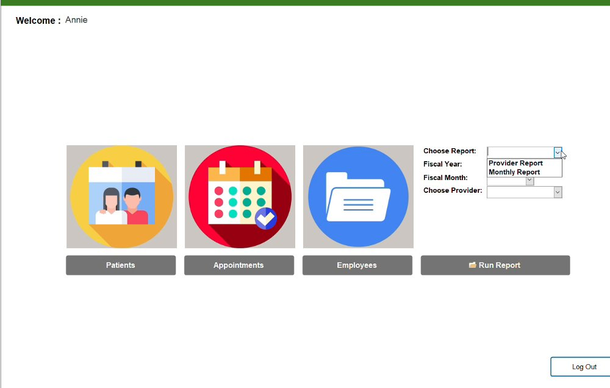
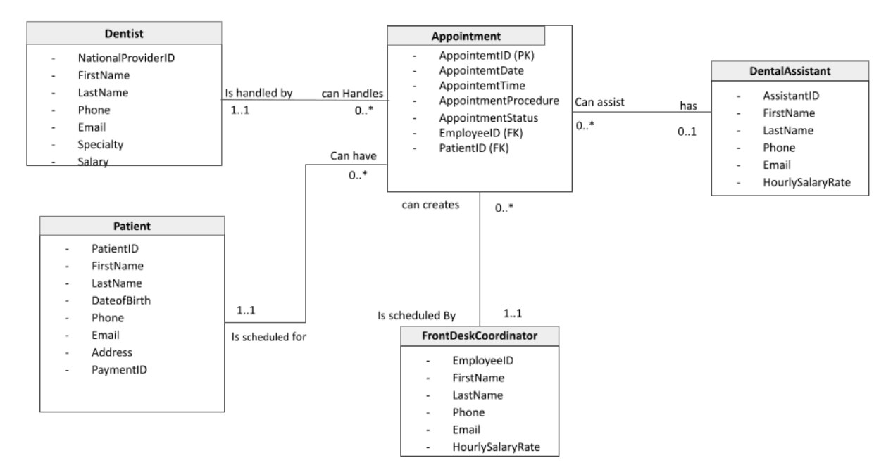
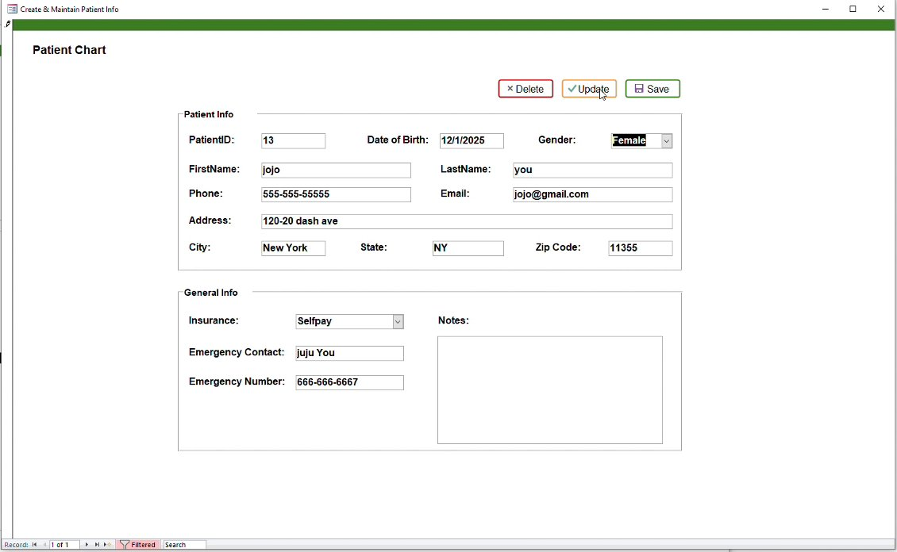
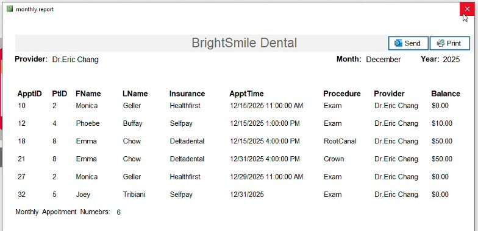

# BrightSmile Dental Database

A Microsoft Access database application for a small dental clinic: patients, appointments, staff, procedures, supplies, and reports in one place.

**Course:** CIS 9340 Principles of Database Management, Baruch College (Fall 2025)
**Type:** Team project
**Tools:** Microsoft Access, SQL, ER modeling (UML notation)

**Demo video:** [Watch the run-through on YouTube](https://www.youtube.com/watch?v=54yVU4n7h6s)
**Write-up:** [xixilin.dev/dental-database.html](https://xixilin.dev/dental-database.html)



---

## The Problem

BrightSmile Dental is the case for this project: a small general dentistry clinic in Queens that has been open for four years. The clinic tracked patients, appointments, billing, insurance, and supply orders with paper charts, Google Sheets, and a wall calendar. As it grew, that setup led to scheduling conflicts, missing clinical notes, slow insurance follow-ups, and little view of inventory and revenue.

The goal was one database application that the dentist, office manager, front desk, and dental assistant could all use.

---

## Design

### ER model

The first model had many entities and was hard to follow. After going back to the business requirements, it was simplified to five main entities: Dentist, Patient, Appointment, Dental Assistant, and Front Desk Coordinator.



- A dentist handles many appointments; each appointment is handled by one dentist.
- A dental assistant can assist in many appointments; an appointment may have one assistant.
- A patient can have many appointments; each appointment is for one patient.
- A front desk coordinator creates many appointments; each appointment is created by one coordinator.

### Normalization

The model was taken through First, Second, and Third Normal Form. Appointment and Appointment_Procedure were split so that each appointment can hold several procedures, and lookup data such as procedures and payment methods moved into their own tables. In the final build, dentists, assistants, and front desk staff were combined into one Employee table with a job title field.

### Final tables

| Table | What it stores |
|---|---|
| PatientTable | Contact details, date of birth, insurance, emergency contact, and notes |
| Appointment | Date, time, status, procedure, provider, clinic notes, and payment balance |
| EmployeeTable | Staff details, job title, work days, hourly rate, and login |
| ProcedureCatalog | Procedures and their default fees |
| AppointmentProcedure | Which procedures were done in each appointment and the fee charged |
| InventoryItem | Supplies on hand and their reorder points |

The full structure is in [`sql/schema.sql`](sql/schema.sql).

---

## What the Application Does

- **Login:** staff sign in with a username and password from the Employee table.
- **Dashboard:** one screen that opens patients, appointments, and employees, and runs reports.
- **Patient, appointment, and employee files:** each list has search and Create buttons, and each record opens in a chart form with Delete, Update, and Save.
- **Reports:** a monthly appointment report and a report by provider, chosen by fiscal year, month, and provider.
- **Queries:** supplies at or below their reorder point, and revenue and visit count by procedure. See [`sql/queries.sql`](sql/queries.sql).

| Patient chart | Monthly report |
|---|---|
|  |  |

All names and details in the screenshots and video are test data.

---

## Repository Contents

```
├── README.md
├── sql/
│   ├── schema.sql      # Table structure of the final database
│   └── queries.sql     # Main queries behind the forms and reports
└── images/             # ER diagram and screenshots from the demo
```

The Access file itself is not included because it contains sample contact records.

---

## My Role

This was a three-person team project.

- Led the project.
- Worked on the ER model and its normalization to Third Normal Form.
- Built the tables and relationships in Microsoft Access.
- Built the login, dashboard, and patient, appointment, and employee forms.
- Wrote the queries and built the monthly and provider reports.
- Led the team's final presentation, recorded the demo, and wrote the final report.

---

## Author

Xixi (Cecilia) Lin, MS Business Analytics (Data Analytics), Baruch College
[xixilin.dev](https://xixilin.dev) · [GitHub](https://github.com/xixi0817)
